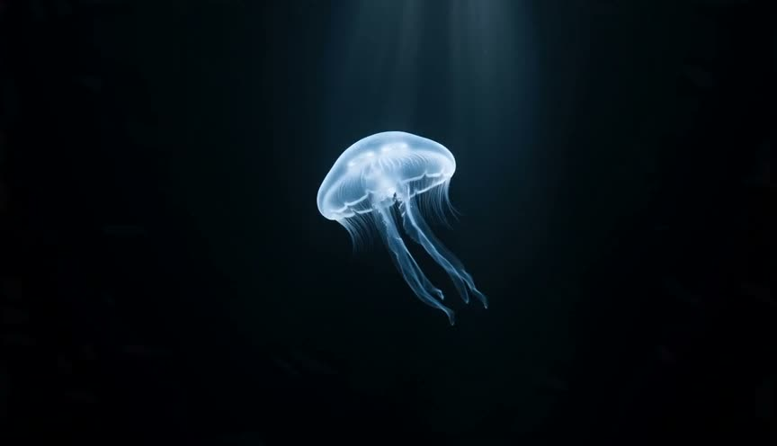
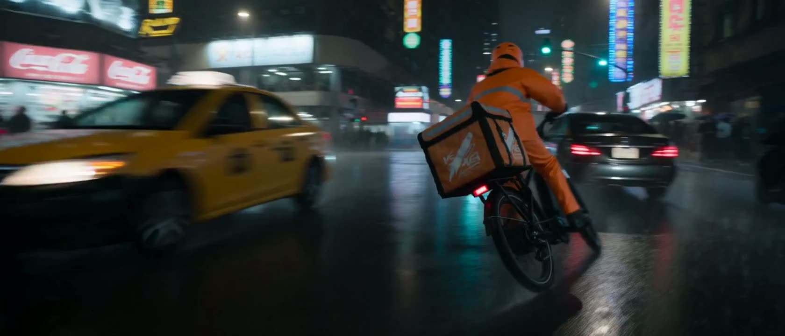
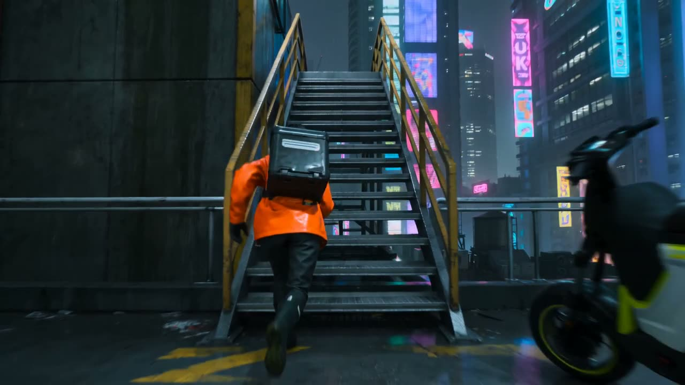
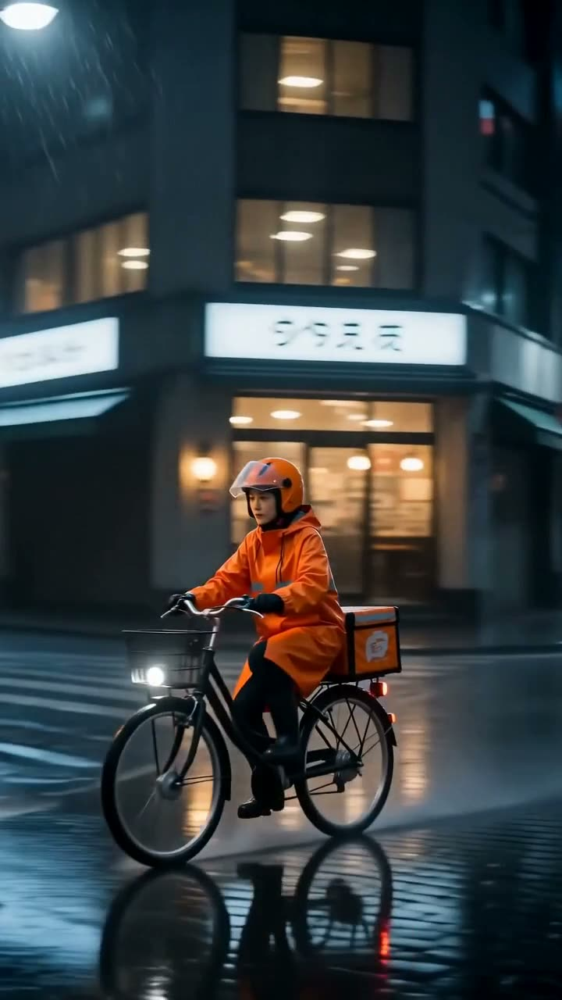

# Seedance 2.0 API

Call ByteDance's **Seedance 2.0** video model from code and see what each channel charges per clip. One request shape covers text-to-video, first/last-frame image-to-video and reference-to-video that mixes images, videos and audio. Output goes up to 4K and 15 seconds, with optional native audio.

One API key reaches every channel that serves Seedance 2.0. [Yir](https://yir.ai/?utm_source=github&utm_medium=repo&utm_campaign=seedance-2.0-api&utm_content=intro) routes each request to the channel that is up and cheapest, falls back when one fails, and bills that channel's published price. No markup, no subscription.

<!-- yir:facts:start -->
| | |
|---|---|
| Model ID | `bytedance/seedance-2.0` (aliases `seedance-2.0`) |
| Maker | ByteDance, released 2026-02-12 ([source](https://seed.bytedance.com/en/blog/official-launch-of-seedance-2-0)) |
| Inputs | Text-to-video, image-to-video, reference-to-video |
| Output | 480p, 720p, 1080p, 4K · 6 aspect ratios (21:9 to 9:16) · 4–15 s · optional native audio |
| Channels on Yir | APIMart, ByteDance, FAL, KIE |
<!-- yir:facts:end -->

## Examples

Generated with this model through Yir; click a frame to play the clip. Prompts are free to reuse, and the cost is what that job was billed.

| | |
|---|---|
| [](images/jellyfish.mp4) | **Jellyfish from a still** · Image-to-video · 480p · 4s · 16:9 · audio · $0.264 via APIMart<br>First frame: a still made with Nano Banana 2.1.<br>`The jellyfish drifts slowly upward through the dark water, its bell pulsing gently, tendrils trailing, the faint shaft of light shimmering above. Slow calm motion, static camera, quiet deep-sea ambience.` |
| [](images/courier-chase.mp4) | **Rainy neon chase** · Text-to-video · 8s · 720p · 21:9 · audio · $1.64 via KIE<br>`Cinematic 21:9 night chase in a rainy neon city. A female bike courier in a bright orange rain jacket and helmet weaves her cargo e-bike through traffic, a delivery box strapped on the back. Cut to a low shot as she jumps a curb onto a market street, splashing through puddles, vendors ducking aside. Cut to a close-up of her determined face under flickering signs. Fast action, stable motion, rain and city sounds.` |
| [](images/courier-parkour.mp4) | **Rooftop parkour** · Text-to-video · 8s · 720p · 16:9 · audio · $1.2159 via ByteDance<br>`The bike courier in an orange rain jacket leaves her e-bike and sprints up a fire escape with the delivery box, vaults a rooftop gap, rolls on landing, and keeps running across wet rooftops under neon glow. Fast, fluid parkour, clear limbs and body mechanics, handheld follow camera, footsteps and rain.` |
| [](images/courier-delivery.mp4) | **Vertical delivery** · Text-to-video · 8s · 720p · 9:16 · audio · $1.64 via KIE<br>`Vertical shot: the bike courier in an orange rain jacket arrives at a tiny ramen shop door, rain dripping off her helmet, and hands the delivery box to an old chef who bows and laughs. She lifts her visor and smiles at the camera, steam rising from the shop, neon sign glowing above. Warm ending, rain and city ambience.` |

Got a better one? Open a PR with the prompt, settings and output.

## Prices by channel

<!-- yir:prices:start -->
| Output | APIMart | KIE |
|---|---:|---:|
| 480p | **$0.264** | $0.38 |
| 720p | **$0.568** | $0.82 |
| 1080p | **$1.4176** | $2.04 |
| 4K | **$2.888** | $4.16 |

Per clip (4s · 16:9), USD. Columns are channel prices as published by Yir on 2026-10-18, and **bold** is the cheapest channel available that day. Yir bills the published price of the channel that ran the job, with no markup, and nothing when the channel bills nothing. [Live prices](https://yir.ai/models/seedance-2?utm_source=github&utm_medium=repo&utm_campaign=seedance-2.0-api&utm_content=prices#model-prices).

Text-to-video, image-to-video and reference-to-video cost the same when the references are images. Native audio costs nothing extra. Prices are for a 4s clip; other durations (4–15s) are priced differently, see live prices. ByteDance and FAL also serve this model with per-job pricing, so they are not listed.
<!-- yir:prices:end -->

## Quick start

```bash
npm install
export YIR_API_KEY=...   # verified new accounts get a one-time trial credit: https://yir.ai/console?utm_source=github&utm_medium=repo&utm_campaign=seedance-2.0-api&utm_content=signup
node examples/generate.mjs "A bike courier in an orange rain jacket weaves through rainy neon traffic at night, handheld follow camera, rain and city sounds." resolution=480p duration=4 aspect_ratio=16:9 generate_audio=true
```

```js
import { createNodeYirClient } from "@yir-ai/sdk/server";

const client = createNodeYirClient();
const job = await client.submitVideo({
  model: "bytedance/seedance-2.0",
  input: { type: "text", prompt: "A bike courier in an orange rain jacket weaves through rainy neon traffic at night, handheld follow camera, rain and city sounds." },
  parameters: { resolution: "480p", duration: 4, aspect_ratio: "16:9", generate_audio: true },
});
const done = await client.waitForJob(job.id);
console.log(done.result.files[0].url, done.billing.total_charged_by_yir);
```

No Node? [`examples/generate.py`](examples/generate.py) uses only the Python standard library, and [`examples/curl.sh`](examples/curl.sh) does the same with curl and jq. Both call `POST https://gateway.yir.ai/v1/videos/generations` with `Authorization: Bearer $YIR_API_KEY`; see the [API reference](https://docs.yir.ai/getting-started/quickstart?utm_source=github&utm_medium=repo&utm_campaign=seedance-2.0-api&utm_content=docs).

## Inputs

<!-- yir:inputs:start -->
| Mode | `input.type` | What you send |
|---|---|---|
| Text-to-video | `text` | A prompt. |
| Image-to-video | `image` | A prompt plus 1 first frame (`first_frame`) and an optional last frame (`last_frame`). |
| Reference-to-video | `reference` | A prompt plus up to 9 reference images (`reference_image`), up to 3 reference videos (`reference_video`) and up to 3 reference audio clips (`reference_audio`); at least one image or video. |
<!-- yir:inputs:end -->

Image-to-video:

```json
{
  "model": "bytedance/seedance-2.0",
  "input": {
    "type": "image",
    "prompt": "The camera slowly pushes in",
    "references": [
      {
        "role": "first_frame",
        "url": "https://example.com/first_frame.jpg"
      },
      {
        "role": "last_frame",
        "url": "https://example.com/last_frame.jpg"
      }
    ]
  },
  "parameters": {
    "resolution": "480p",
    "duration": 4,
    "aspect_ratio": "16:9",
    "generate_audio": true
  }
}
```

Reference-to-video:

```json
{
  "model": "bytedance/seedance-2.0",
  "input": {
    "type": "reference",
    "prompt": "The camera slowly pushes in",
    "references": [
      {
        "role": "reference_image",
        "url": "https://example.com/image.jpg"
      },
      {
        "role": "reference_video",
        "url": "https://example.com/video.mp4"
      }
    ]
  },
  "parameters": {
    "resolution": "480p",
    "duration": 4,
    "aspect_ratio": "16:9",
    "generate_audio": true
  }
}
```

With reference videos or audio the quote can come back without an amount; the job is then billed at what the channel charges.

## Parameters

<!-- yir:params:start -->
| Parameter | Values | Default | Notes |
|---|---|---|---|
| `duration` | integer, 4–15 | `4` | Output video duration in seconds. |
| `resolution` | `480p`, `720p`, `1080p`, `4K` | `480p` | Output resolution. |
| `aspect_ratio` | `21:9`, `16:9`, `4:3`, `1:1`, `3:4`, `9:16`, `adaptive` | `16:9` | Output aspect ratio. |
| `return_last_frame` | `false`, `true` | `false` | Return the final video frame as an additional image when supported by the selected supply. |
| `generate_audio` | `false`, `true` | `false` | Generate native audio with the video. |
| `n` | `1` | `1` | Number of outputs from one API request (one Job), not the application batch size. For multiple Jobs, submit separate requests; n=1 does not prevent application-managed batching. |
<!-- yir:params:end -->

## Good to know

- The three courier clips are separate jobs with one character: every prompt names the same bike courier in an orange rain jacket, which keeps her look consistent from shot to shot.
- Set `return_last_frame: true` to get the final frame back as an image (on channels that support it), then send it as the next clip's `first_frame` to continue the shot.
- Draft at 480p and the default 4 seconds; that is the cheapest row in the table. Raise resolution and `duration` once the motion is right.

## Why route instead of calling one channel

- **Fallback.** If a channel is down or rejects the job, the same request moves to the next one. You are only billed for attempts a channel actually charged.
- **Same fields on every channel.** Text, image and reference inputs use the same fields whichever channel runs the job; Yir translates them to each channel's API. [Compare channels](https://yir.ai/models/seedance-2?utm_source=github&utm_medium=repo&utm_campaign=seedance-2.0-api&utm_content=grades#model-prices).
- **Content safety.** Every request goes through content moderation; there is no "uncensored" mode.

## Updates

The facts, price table, inputs and parameters above are regenerated daily from Yir's public model API. Prices are channel list prices at that time, not a quote; quote the request before submitting, as the examples do. [Model page](https://yir.ai/models/seedance-2?utm_source=github&utm_medium=repo&utm_campaign=seedance-2.0-api&utm_content=model).

## License

MIT. Example clips were generated through Yir and may be reused freely.
